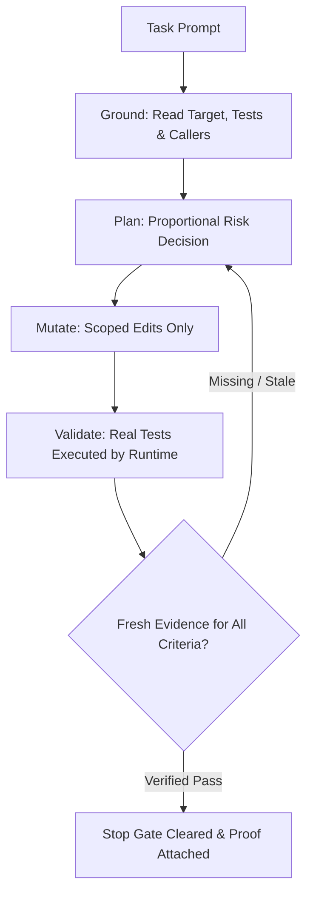

<div align="center">

# ⚡ PROGRAVITY

### **Model-Agnostic Reliability Runtime for AI Coding Agents**

*Gives Gemini Claude-grade engineering discipline: read before writing, plan in proportion to risk, verify against executed evidence, and report only what the evidence supports.*

[](https://github.com/SalauddinAhmad/progravity/actions/workflows/progravity.yml)
[](https://skills.sh/SalauddinAhmad/progravity)
[](LICENSE)
[](pyproject.toml)
[](docs/production-readiness.md)

---

**[⚡ Quickstart](#-quickstart)** •
**[🛡️ The Six Invariants](#-the-six-invariants)** •
**[🏗️ How It Works](#-how-it-works)** •
**[📦 Installation](#-installation)** •
**[🧪 Benchmark Status](#-benchmark-status)** •
**[📚 Documentation](#-documentation)**

</div>

<br>

> [!NOTE]
> **Research preview: comparative performance is not yet measured.**
> PROGRAVITY changes the engineering process, not model weights.

---

## 💡 The Problem

Coding agents fail in predictable, frustrating ways:
- ❌ **Blind Edits:** Modifying files they never read or inspected.
- ❌ **Uncontrolled Scope:** Making broad, unintended changes across multiple packages for narrow tasks.
- ❌ **Stale / Missing Proof:** Running tests before their final edit and claiming success with outdated results, or running no tests at all.
- ❌ **Looping Retries:** Repeating the exact byte-identical failed tool call until quota runs out.
- ❌ **Unbacked Completion:** Declaring "Done!" with zero verifiable machine proof.

Each of these is a **process failure, not a capability failure**: the underlying model has the intelligence to do the right thing, but nothing in the execution loop enforces it.

**Progravity inserts that missing discipline into the loop.** Six invariants define the contract. Portable skills instruct the model. Native hooks enforce boundaries mechanically. Deterministic validators execute real checks. A completion gate blocks exit until proof is verified.

---

## 🎯 Why Now?

In late 2026, third-party model access in Antigravity shifted under licensing restrictions: Claude access is now reserved for direct, non-promotional paid tiers, and legacy Claude 4.6 access is deprecated. Users on promotional routes, student plans, and free tiers lost the Claude option they built their workflows around.

What remains universally accessible is **Gemini 3.8 Flash**: an agile, highly capable agentic model that still suffers from the classic unconstrained agent failures.

**Progravity does not bring Claude back.** Instead, it endows the model you have with the rigorous working discipline developers valued: grounded edits, declared write scope, executed cryptographic proof, and zero completion without evidence.

---

## 🛡️ The Six Invariants

These invariants are the canonical contract. Everything in this runtime exists to enforce them:

| # | Invariant | Description & Enforcement |
|:---:|:---|:---|
| **1** | **Ground before mutating** | The agent must read target files, imports, and tests before editing. State is observed, never guessed. |
| **2** | **Stay in declared scope** | Each task defines `allowed_write_scope`. Outside writes are denied fail-closed with the violating path reported. |
| **3** | **Completion needs evidence** | A task is complete only when a Progravity-owned validator passed *after* the latest file mutation. |
| **4** | **Never exact-retry a failure** | Byte-identical retries of failed actions are blocked. You must change diagnosis, context, or strategy first. |
| **5** | **Satisfy the contract** | Structured acceptance criteria and their bound validators gate completion. Unrelated test passes prove nothing. |
| **6** | **Say what you cannot verify** | Unverifiable claims must be explicitly marked. Uncertainty lowers confidence instead of masquerading as truth. |

---

## 🏗️ How It Works

Progravity structures the entire agent lifecycle into an evidence-driven state machine:



### Direct Comparison

| Stage | Default Agent Behavior | Agent + Progravity |
|:---|:---|:---|
| **Reading Code** | Edits blind when context is long or confidence is high. | **Enforced read-before-write:** Mutating an unread file is denied. |
| **Planning** | Plans ad-hoc; no structured record survives. | **Adaptive risk tier:** Emits machine-readable plan (`direct` to `replan`) with reason codes. |
| **Write Scope** | Can modify any reachable workspace file. | **Strict scope guard:** Outside edits are blocked with offending path identified. |
| **Running Checks** | Often tests before final edit; cites prose. | **Owned validator execution:** Timestamped strictly after last mutation, SHA-256 hashed. |
| **Retrying Errors** | Repeats identical failed calls, burning quota. | **Fingerprint ban:** Exact retries blocked until diagnosis or strategy changes. |
| **Completion** | Declares complete without independent receipts. | **Cryptographic Stop Gate:** Demands fresh PASS per criterion over an intact hash chain. |

---

## 📦 Installation

Choose from three setups based on your desired level of enforcement:

### 1. Core (Recommended Default)
*Portable behavioral policy delivered as Agent Skills for any host.*

```bash
npx skills add SalauddinAhmad/progravity --skill progravity --agent antigravity --yes
```

Then prompt your agent:
```text
Use Progravity to solve this task and verify the result.
```

### 2. Native (Antigravity Plugin)
*Full runtime enforcement with PreToolUse, PostToolUse, PostInvocation, and Stop hooks.*

```bash
git clone --depth 1 https://github.com/SalauddinAhmad/progravity.git
cd progravity
bash scripts/build-native-bundle.sh
agy plugin install "$PWD/dist/progravity-antigravity"
agy plugin validate "$PWD/dist/progravity-antigravity"
```

### 3. OpenCode Adapter
*Permission profile and `tool.execute.before` guard shim for OpenCode.*

```bash
progravity init --host opencode --profile balanced
```

---

## 🚀 Quickstart

Once installed, use the `progravity` CLI to inspect health, verify contracts, and run tests:

```bash
# 1. Check runtime and environment health
progravity doctor

# 2. Make an adaptive planning decision
progravity decide --signals '{"files": 2, "dependent_files": true}'

# 3. Discover repo-aware test validators
progravity validators --depth targeted

# 4. Run full unit test suite
python -m unittest discover -s tests
```

---

## 🔒 Security & Enforcement Semantics

Progravity distinguishes instruction from mechanical enforcement:

| Capability | Core Mode | Native (Antigravity) | OpenCode |
|:---|:---:|:---:|:---:|
| **Read-Before-Write Policy** | Instruction | Instruction + Action Lock | Permission Profiles |
| **Write Scope Gating** | ❌ | Hook Deny (`PreToolUse`) | Shim Deny + Permissions |
| **Destructive Confirmation** | ❌ | `force_ask` prompt | Hard Deny |
| **Evidence Ledger** | ❌ | Automatic SHA-256 Hash Chain | Manual CLI Recording |
| **Completion Gate** | ❌ | Automated `Stop` Hook | Manual (`summarize` + verify) |
| **Failure Policy** | Fail-Open | **Fail-Closed** | **Fail-Closed** |

> [!WARNING]
> Hooks are workflow policy controls, not an OS sandbox. Full security details and boundary definitions are documented in [SECURITY.md](SECURITY.md).

---

## 🧪 Benchmark Status

ProgravityBench currently holds **30 registered task specifications across 10 planned lanes**: task design, schemas, a runner, and smoke fixtures. That is infrastructure, not results. No solve rates, no requirement-coverage numbers, no token or latency comparisons, and no model rankings are published, because the preconditions for a credible comparison do not exist yet: pinned tasks, hidden independent validators, identical task sets across baseline and treatment, fixed model and host revisions, repeated runs in clean isolation, recorded failures, and reported overhead with uncertainty. Until then, every performance statement in this repository is a hypothesis with its status labeled. Methodology and release gates: [docs/benchmark.md](docs/benchmark.md), [docs/production-readiness.md](docs/production-readiness.md). The latest hardening audit, with reproductions and residual limitations, is [docs/audits/v5-audit.md](docs/audits/v5-audit.md).

---

## 🔬 Related Work

Each source below motivates one core architectural mechanism:

- **[ReAct (Yao et al., 2022)](https://openreview.net/forum?id=WE_vluYUL-X):** Grounding reasoning in actions and observations. Motivates Invariant 1 (observed file state before editing).
- **[Plan-and-Solve (Wang et al., 2023)](https://aclanthology.org/2023.acl-long.147/):** Explicit decomposition for multi-step tasks. Motivates contracts plus adaptive planning records.
- **[Huang et al. (2023)](https://openreview.net/forum?id=IkmD3fKBPQ):** Unaided self-correction fails on complex tasks. Motivates Invariant 3 (external executed validators over self-review).
- **[SWE-bench (Jimenez et al., 2024)](https://openreview.net/forum?id=VTF8yNQM66):** Evaluating repository state rather than final prose. Motivates executed validators and the completion gate.
- **[Harness-Bench (2026)](https://arxiv.org/abs/2605.27922):** Evaluating model-plus-harness configurations as complete systems.

---

## 📈 Star History

<div align="center">

[](https://star-history.com/#SalauddinAhmad/progravity&timeline)

</div>

---

## 📚 Documentation

<div align="center">

| Getting Started | Core Architecture | Specifications |
|:---|:---|:---|
| 📖 [Quickstart Guide](docs/quickstart.md) | 🏛️ [Core Concepts](docs/concepts.md) | 📋 [Task Contracts](docs/configuration.md) |
| 🛠️ [Installation Guide](docs/install.md) | 🔌 [Host Architecture](docs/hosts.md) | 🔬 [Research Foundations](docs/research.md) |
| 🔍 [Troubleshooting](docs/troubleshooting.md) | 🛡️ [Security Policy](SECURITY.md) | 📐 [Architecture Decisions (ADR)](docs/adr/) |

</div>

---

## 🤝 Contributing

We welcome community contributions! Please review [CONTRIBUTING.md](CONTRIBUTING.md) and [SECURITY.md](SECURITY.md) before submitting pull requests.

Working agreement:
1. Ground before mutating: Read existing tests and implementations first.
2. Maintain high verification standards: Add regression tests for any confirmed bug.
3. Keep changes focused and reviewable.

---

## 📄 License & Attribution

This project is licensed under the **[MIT License](LICENSE)** © 2026 Salauddin Ahmad.  
If you use Progravity in your research, please cite using [CITATION.cff](CITATION.cff).
